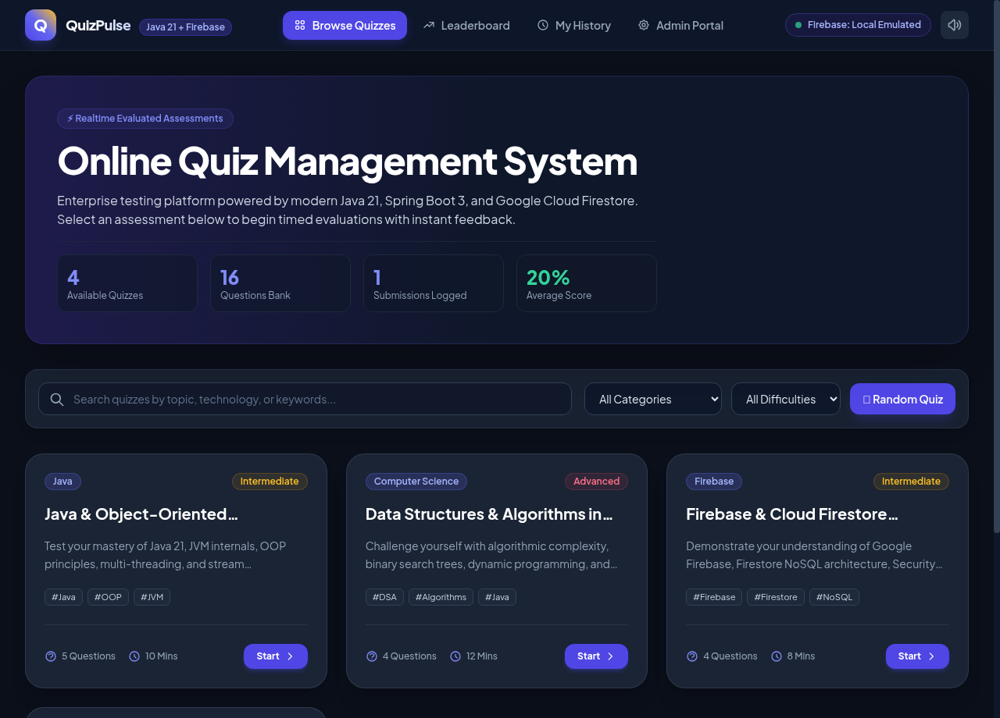
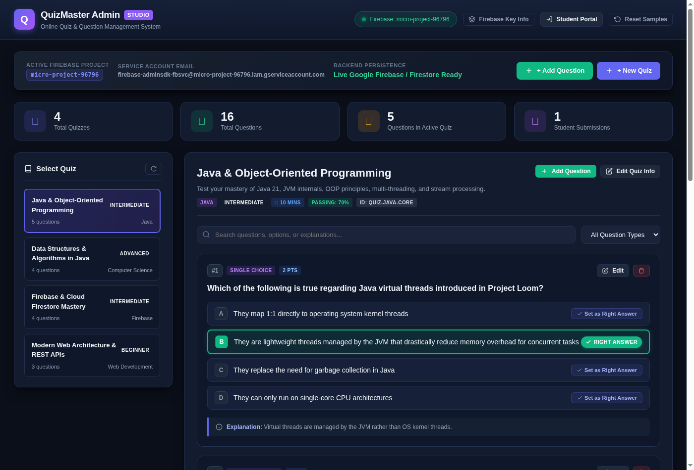
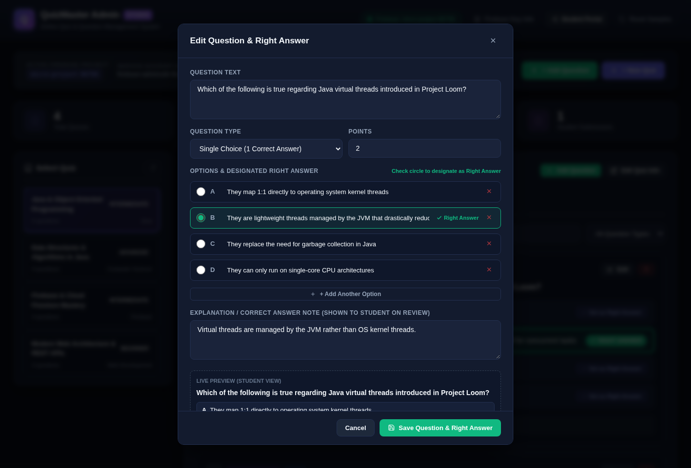
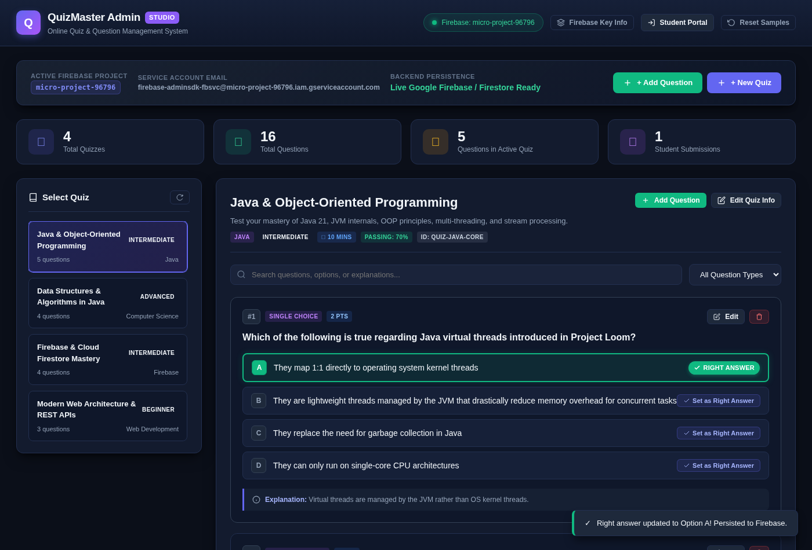

# 🚀 Online Quiz Management System (Java + Firebase + Android APK)

[](https://www.oracle.com/java/)
[](https://spring.io/projects/spring-boot)
[](OnlineQuizSystem.apk)
[](https://firebase.google.com/)
[](LICENSE)

An enterprise-grade, full-stack **Online Quiz & Exam Management System** built with **Java 21**, **Spring Boot 3**, **Google Firebase Firestore**, and a **Native Android Application (`.apk`)** for mobile exams. Featuring real-time timed assessments, instant scoring and grade calculation, educational explanations, admin question bank management, leaderboards, printable certificates of achievement, and offline mobile exam capability.

---

## 📱 Quick Links & Downloads

| Resource | Link / Access | Description |
| :--- | :--- | :--- |
| **Android App (APK)** | [📥 **Download OnlineQuizSystem.apk**](OnlineQuizSystem.apk) | Ready-to-install Android package for student mobile exams |
| **GitHub APK Direct Link** | [🔗 **Raw GitHub APK Download**](https://github.com/vinaynayak2007/Online-Quiz-Management-System/raw/main/OnlineQuizSystem.apk) | Direct APK download link from the GitHub repository |
| **GitHub Repository** | [🌐 **vinaynayak2007/Online-Quiz-Management-System**](https://github.com/vinaynayak2007/Online-Quiz-Management-System) | Full source code, Android client, and backend |
| **Web Student Portal** | [🖥️ `http://localhost:8080/`](http://localhost:8080/) | Interactive exam runner, countdown timers, scorecards |
| **Question Studio (Admin)** | [⚙️ `http://localhost:8080/admin.html`](http://localhost:8080/admin.html) | Standalone visual question & right-answer control suite |

---

## 📲 Android Mobile Exam Application (`OnlineQuizSystem.apk`)

The included Android application (`OnlineQuizSystem.apk`, signed and release-ready) allows students to take exams directly on their Android devices with 100% offline capability or online syncing.

### 🌟 Android App Features
- **Standalone Offline Exam Engine**: Pre-bundled with comprehensive question banks across Java 21, Data Structures & Algorithms, Google Firebase Cloud Architecture, and Modern Web Development.
- **Real-Time Timed Exams**: Interactive ticking timer with automatic warning states and instant auto-submit on countdown expiry.
- **Question Flagging & Navigator**: Jump effortlessly between questions and review marked items before final submission.
- **Immediate Evaluation & Scorecard**: Instant grading with percentage, letter grade (A+, A, B, C, F), and question-by-question breakdown showing correct choices and detailed teacher explanations.
- **Native Android Hardware Acceleration**: Smooth, high-performance animations, fluid touch scrolling, and zero lag on mobile screens.

### 📥 How to Install the APK on Android
1. **Download the APK**:
   - Direct download via browser: [`OnlineQuizSystem.apk`](https://github.com/vinaynayak2007/Online-Quiz-Management-System/raw/main/OnlineQuizSystem.apk)
   - Or when running the server locally: `http://localhost:8080/OnlineQuizSystem.apk`
2. **Allow Installation from Unknown Sources**:
   - On Android 8.0+: When prompted after downloading, tap **Settings** and toggle **"Allow from this source"**.
   - On older Android versions: Go to **Settings > Security > Unknown Sources** and enable it.
3. **Install & Launch**:
   - Tap `OnlineQuizSystem.apk` in your phone's notification panel or Downloads folder.
   - Tap **Install** and then **Open**.
   - Start taking your quizzes immediately!

---

## 📸 Application Screenshot Previews

### 1. Student Quiz Runner & Dashboard (`index.html`)


### 2. Dedicated Single-Page Question & Right Answer Studio (`admin.html`)


### 3. Interactive Question Editor & Real-Time Options Builder Modal


### 4. Instant 1-Click Right Answer Toggle with Live Feedback


---

## 🌟 Highlights & Key Features

### 🛠️ Dedicated Question & Right Answer Studio (`admin.html`)
- **Single-Page Administrative Suite**: Fully responsive control center accessible at `http://localhost:8080/admin.html` or `/admin`.
- **Live Visual Right Answer Highlighting**: Clear emerald green borders, radiant badges, and indicator pills distinguishing the designated correct answer from distractors.
- **Instant 1-Click Right Answer Switcher**: Admin can change the designated right answer directly on any question card with a single click, instantly syncing via `PATCH /api/quizzes/{quizId}/questions/{questionId}/right-answer`.
- **Comprehensive Question Modal**: Full-featured creator/editor supporting:
  - Dynamic option builders (add/remove options, rename choices).
  - Radio buttons for single-choice and checkboxes for multiple-choice questions.
  - Question statement, points weight, and teacher explanations.
  - Live side-by-side student preview box before committing changes.
- **Quiz Hierarchy Selector**: Interactive sidebar to toggle between different assessment tracks (Java, Algorithms, Firebase Cloud, Web Dev) or generate new quizzes.
- **Search & Filter Engine**: Instant search across question prompts, option strings, and explanations, plus filtering by single choice, multiple choice, and true/false.

### 🎓 Student Quiz Portal (`index.html`)
- **Interactive Quiz Player**: Clean, distraction-free interface with custom options selectors and question navigation.
- **Real-Time Countdown Timer**: Live ticking timer with visual and auditory warnings when under 60 seconds.
- **Question Navigator & Flagging**: Jump between questions, mark questions for review, and track answered vs unanswered status.
- **Instant Evaluation Engine**: Automatically grades single-choice, multiple-choice, and true/false questions upon submission.
- **Question-by-Question Review**: Displays candidate's choice vs correct answers with in-depth educational explanations.
- **Printable Certificate of Achievement**: Generates a high-resolution, printable completion certificate with verification ID.
- **Hall of Fame & Leaderboard**: Real-time ranking with gold, silver, and bronze badges based on score and completion time.
- **Sound Effects**: Native Web Audio API sound feedback for clicks, timer alerts, and passing/failing chimes.

### 🔥 Google Firebase Integration
- **Project Configuration**: Integrated with Google Firebase project `micro-project-96796` (`firebase-adminsdk-fbsvc@micro-project-96796.iam.gserviceaccount.com`).
- **Cloud Firestore Storage**: Connects directly to Google Cloud Firestore via the official Firebase Admin SDK (`com.google.firebase:firebase-admin:9.2.0`).
- **Hybrid Auto-Fallback Emulator**: If Firestore API is pending activation on GCP, the system runs seamlessly in local emulated mode (file-backed JSON in `data/`), ensuring zero-friction setup and zero data loss.
- **Runtime Firebase Configuration**: Switch to live Firebase at any time through the UI by pasting your service account private key JSON.
- **Android Client Module**: Includes a native Android Java client architecture in `android-client/` with Firestore integration helpers.

---

## 🏛️ Architecture & Tech Stack

```
Online-Quiz-Management-System/
├── src/main/java/com/quizsystem/
│   ├── QuizApplication.java             # Spring Boot Main Entrypoint
│   ├── config/
│   │   ├── FirebaseConfig.java          # Firebase Admin SDK & Credentials Initializer
│   │   └── WebConfig.java               # CORS & Static Resource Routing
│   ├── model/
│   │   ├── Quiz.java                    # Quiz Entity
│   │   ├── Question.java                # Question Model (MCQ, True/False, Multi-select)
│   │   ├── Attempt.java                 # Student Submission & Results Record
│   │   ├── QuizSubmission.java          # Request Payload
│   │   ├── QuizResult.java              # Evaluated Scorecard with Explanations
│   │   └── FirebaseStatus.java          # Connection State Model
│   ├── service/
│   │   ├── FirebaseService.java         # Firestore Cloud & Emulated Storage Service
│   │   ├── QuizService.java             # Quiz CRUD & Public Sanitization Logic
│   │   └── AttemptService.java          # Grading Engine & Leaderboard Computations
│   └── controller/
│       ├── QuizController.java          # /api/quizzes REST Endpoints
│       ├── AttemptController.java       # /api/attempts & submission evaluations
│       ├── LeaderboardController.java   # /api/leaderboard REST Endpoints
│       ├── AnalyticsController.java     # /api/analytics Admin Metrics
│       └── FirebaseController.java      # /api/firebase configuration & status
├── src/main/resources/
│   ├── application.properties           # Spring Boot & Port 8080 Configuration
│   ├── initial-quizzes.json             # Seed Quizzes & Question Banks
│   └── static/                          # Modern Single-Page Web Frontend
│       ├── index.html                   # Responsive Dashboard & Quiz Arena
│       ├── css/styles.css               # Modern Custom Theme & Print Certificate Styling
│       └── js/app.js                    # Web Audio, Timer Engine, State & API Client
├── android-client/                      # Android Java + Firebase Client Reference
│   ├── build.gradle
│   └── src/main/java/com/quizsystem/android/
└── pom.xml                              # Maven Configuration & Dependencies
```

---

## 🚀 Getting Started

### Prerequisites
- **Java 17 or Java 21** installed (`java -version`)
- **Maven 3.8+** (or use the included `./mvnw` wrapper)

### Running the Application

1. **Clone the repository:**
   ```bash
   git clone https://github.com/vinaynayak2007/Online-Quiz-Management-System.git
   cd Online-Quiz-Management-System
   ```

2. **Build and Run with Maven Wrapper:**
   ```bash
   ./mvnw spring-boot:run
   ```
   *On Windows:*
   ```cmd
   mvnw.cmd spring-boot:run
   ```

3. **Access the Application:**
   Open your browser and navigate to:
   ```
   http://localhost:8080
   ```

---

## 🔥 Connecting to Google Firebase

By default, the application runs in **Local Emulated Mode** with preloaded sample quizzes and persistent JSON storage. To connect to your live Firebase project:

1. Go to the [Firebase Console](https://console.firebase.google.com/).
2. Create or open your project, then navigate to **Project Settings** > **Service accounts**.
3. Click **Generate new private key** and download `serviceAccountKey.json`.
4. Place `serviceAccountKey.json` into the root directory of the project, or set the environment variable:
   ```bash
   export GOOGLE_APPLICATION_CREDENTIALS=/path/to/serviceAccountKey.json
   ```
5. *Alternatively*, open the running app at `http://localhost:8080`, click the **Firebase Ready** badge in the top navigation, and paste your JSON private key directly into the configuration modal!

---

## 📡 REST API Documentation

| Method | Endpoint | Description |
|---|---|---|
| `GET` | `/api/quizzes` | Get list of public active quizzes (answers sanitized for security) |
| `GET` | `/api/quizzes/{id}` | Get specific quiz questions for student taking mode |
| `POST` | `/api/quizzes/{id}/submit` | Submit answers, calculate score, and return detailed scorecard |
| `GET` | `/api/quizzes/{id}/admin` | Get complete quiz including correct answers and explanations |
| `POST` | `/api/quizzes` | Create a new quiz and questions bank (Admin) |
| `PUT` | `/api/quizzes/{id}` | Update existing quiz metadata (Admin) |
| `DELETE` | `/api/quizzes/{id}` | Delete quiz (Admin) |
| `GET` | `/api/quizzes/{id}/questions` | Get all questions with answers for a quiz (Admin Studio) |
| `GET` | `/api/quizzes/{id}/questions/{qId}` | Get single question details with options and answers |
| `POST` | `/api/quizzes/{id}/questions` | Add a new question to a quiz |
| `PUT` | `/api/quizzes/{id}/questions/{qId}` | Update question text, options, right answers, points, and explanation |
| `PATCH` | `/api/quizzes/{id}/questions/{qId}/right-answer` | Instant 1-click update of designated correct answer index |
| `DELETE` | `/api/quizzes/{id}/questions/{qId}` | Delete question from quiz |
| `GET` | `/api/leaderboard` | Get ranked leaderboard entries |
| `GET` | `/api/analytics` | Get aggregate system statistics |
| `GET` | `/api/firebase/status` | Check live Firebase Firestore connection status |
| `POST` | `/api/firebase/configure` | Dynamically apply Firebase service account credentials |

---

## 🧪 Running Automated Tests

Run the included JUnit 5 integration tests to verify context initialization, evaluation engines, and security sanitization:

```bash
./mvnw test
```

---

## 📱 Android Client Reference

A ready-to-import native Android Java client is included in the `android-client/` directory. It demonstrates:
- Connecting to Firebase Firestore directly from mobile
- Fetching quizzes and questions dynamically
- Managing countdown timers on Android
- Submitting quiz attempt results to Firestore

---

## 👤 Author & Maintainer

- **Developer**: Vinay N ([@vinaynayak2007](https://github.com/vinaynayak2007))
- **Project**: Online Quiz Management System
- **Repository**: [vinaynayak2007/Online-Quiz-Management-System](https://github.com/vinaynayak2007/Online-Quiz-Management-System)
- **GitHub Project Board**: [Online Quiz Management System Project #7](https://github.com/users/vinaynayak2007/projects/7)

---

## 📄 License
This project is licensed under the MIT License.
